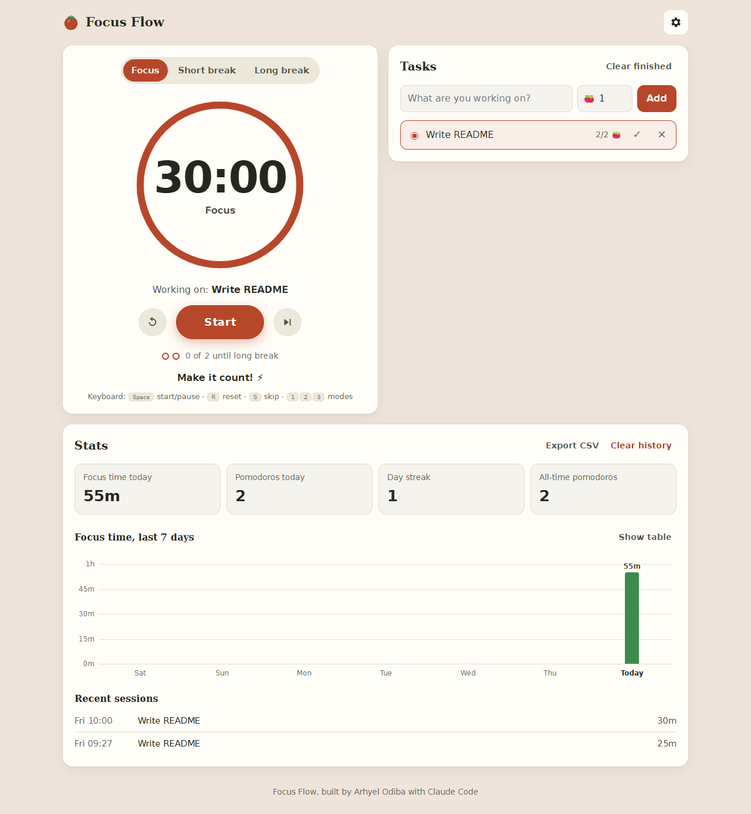

# 🍅 Focus Flow

A Pomodoro timer for the web, with tasks, stats, custom durations, alarm sounds, notifications, dark mode, and offline support.



## Features

- **Pomodoro cycle:** focus, short break, and long break, with a long break after every N focus sessions
- **Custom durations:** set focus, short break, long break, and sessions-per-cycle (saved between visits)
- **Accurate timing:** keeps running in a background tab and survives page reloads
- **Alerts:** five built-in alarm sounds with volume control, desktop notifications, and vibration on phones
- **Auto-start:** optionally start breaks and/or focus sessions automatically
- **Tasks:** add tasks with estimated pomodoros, pick the one you're on, and finished sessions count toward it
- **Stats:** focus time today, pomodoros today, day streak, a 7-day chart (with a table view), and recent sessions
- **Export:** download your full history as CSV
- **Dark mode:** follows your system setting, or you can force light or dark
- **Installable & offline:** a PWA you can install to your desktop or phone home screen
- **Keyboard shortcuts:** `Space` start/pause, `R` reset, `S` skip, `1` `2` `3` switch modes

## Run it locally

No build step or dependencies are needed; it's plain HTML, CSS, and JavaScript.

- **Quickest:** double-click `index.html`. (Offline mode and notifications need the server option below.)
- **With a local server** (needs [Node.js](https://nodejs.org)):
  ```bash
  npx serve .
  ```
  Then open the address it prints (usually http://localhost:3000).

## Project structure

```
focus-flow/
├── index.html            # Page layout
├── css/style.css         # Botanical Garden theme, light + dark
├── js/app.js             # Timer, tasks, stats, settings, sounds
├── sw.js                 # Service worker (offline + notifications)
├── manifest.webmanifest  # Makes the app installable
├── icons/icon.svg        # Tomato icon
└── docs/                 # Screenshots for this README
```

All your data (settings, tasks, history) stays in your own browser's `localStorage`. Nothing is sent anywhere.

## How it was built

Focus Flow started as an Android (Kotlin) Pomodoro app and was rebuilt for the web together with [Claude Code](https://claude.com/claude-code), using these Claude skills:

- **theme-factory:** the *Botanical Garden* theme (fern green, marigold, terracotta, cream; serif headings, sans body)
- **dataviz:** the 7-day chart's bar colors were checked with its palette validator for light and dark mode, and the chart follows its rules (thin rounded bars, hover tooltips, a table view, selective labels)

The original app's color-per-mode design, motivational messages, session dots, and "celebration bounce" carry over.

## Roadmap

- [ ] Weekly/monthly stats views
- [ ] Task notes and tags
- [ ] Sync across devices

## License

[MIT](LICENSE) © 2026 Arhyel Odiba
